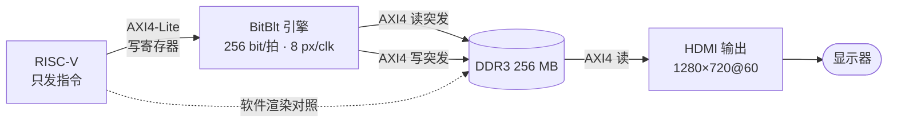
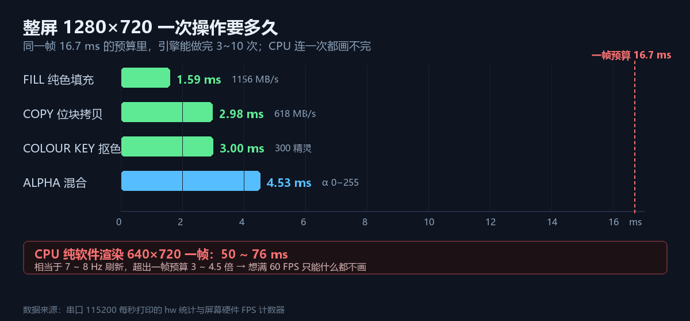
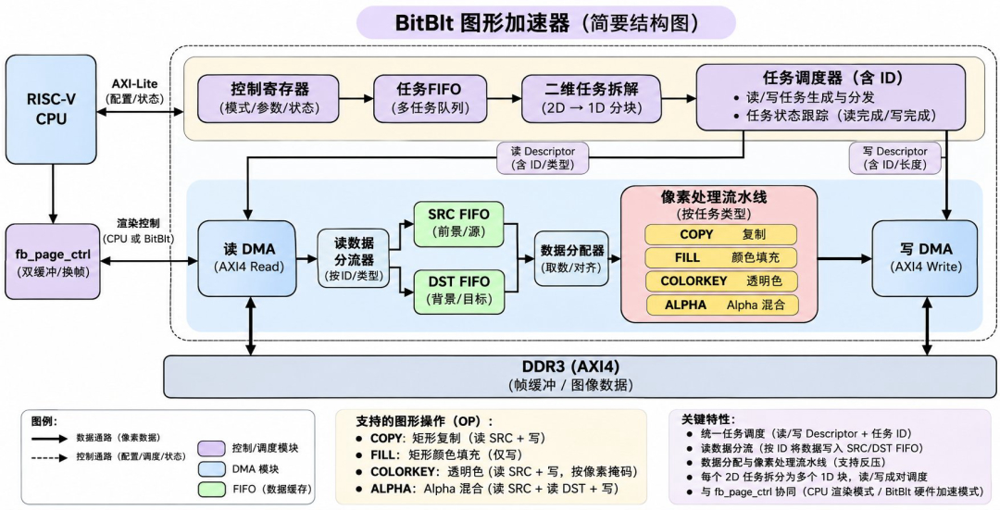
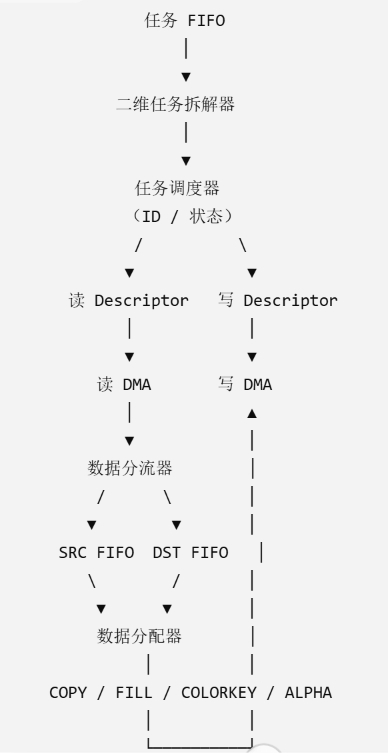
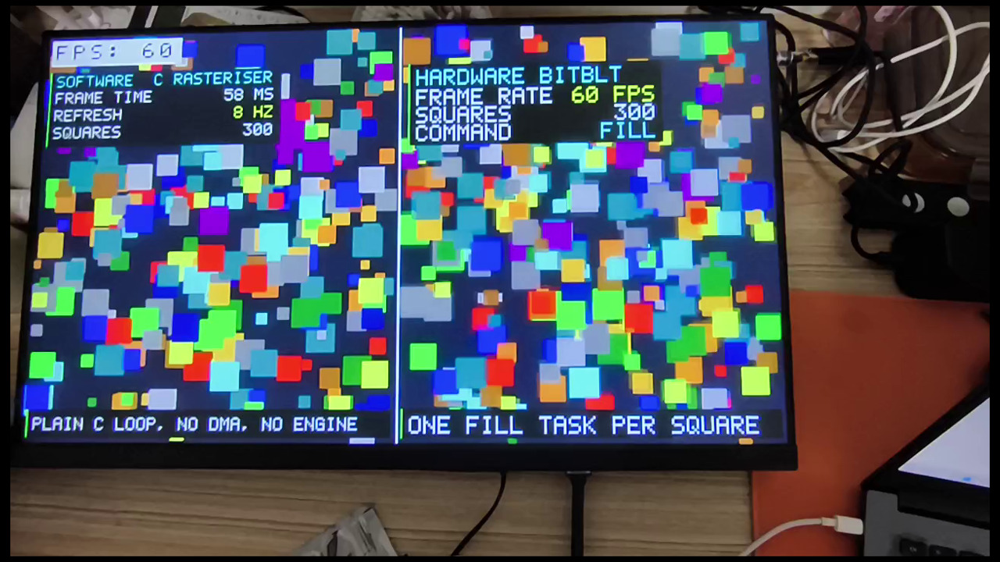
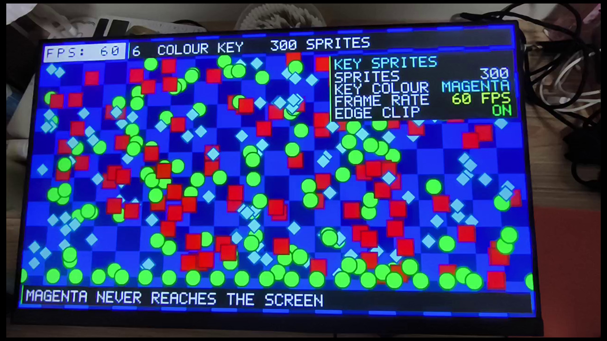
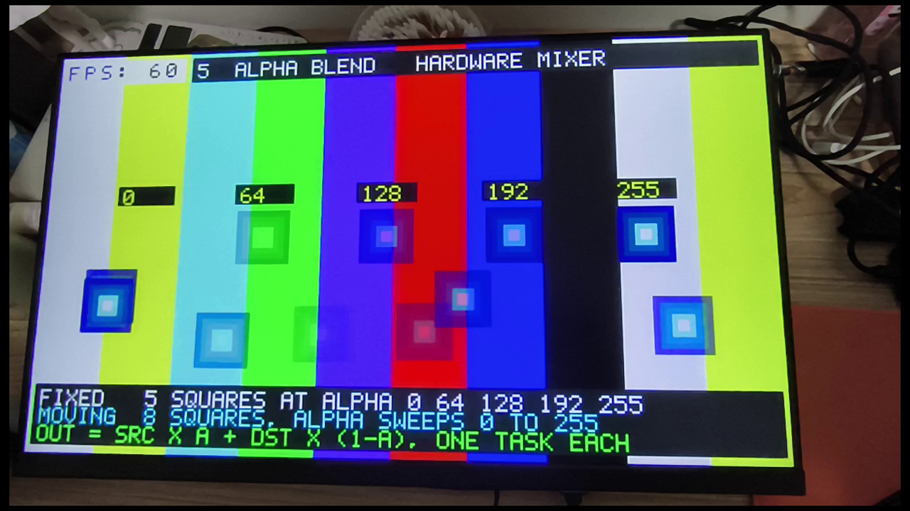
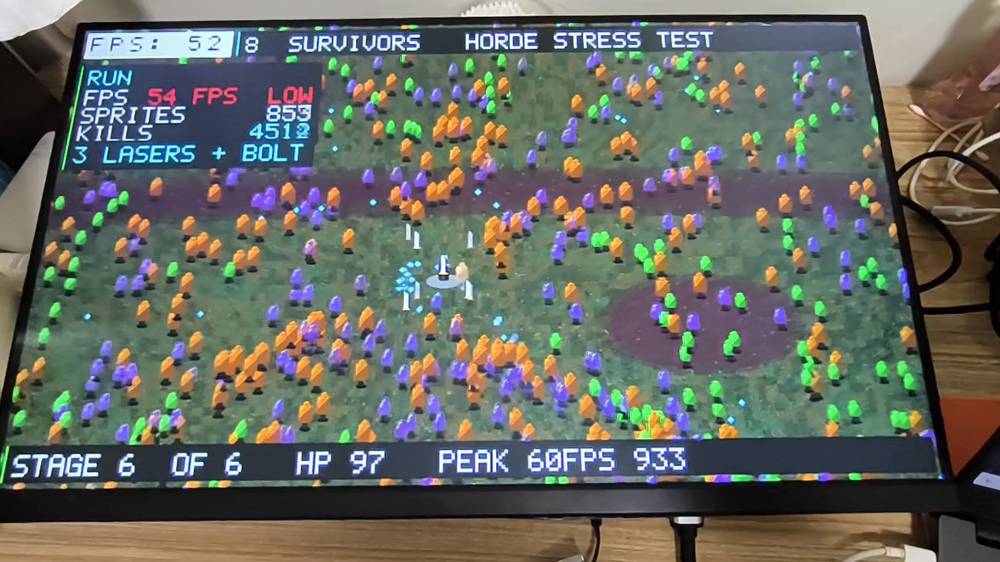
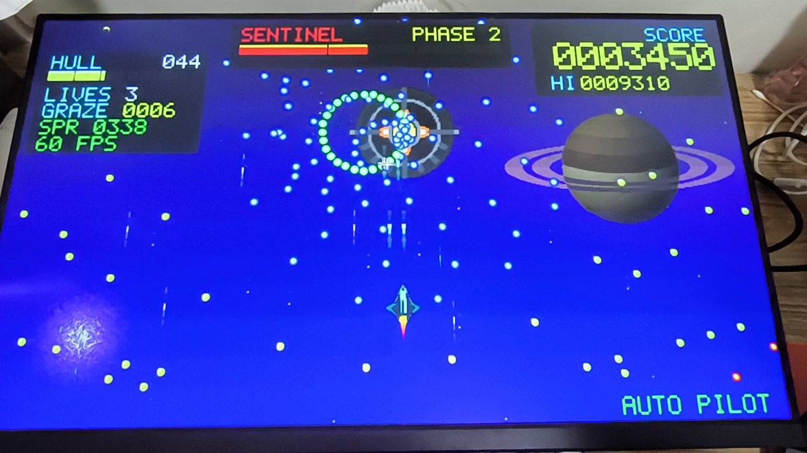
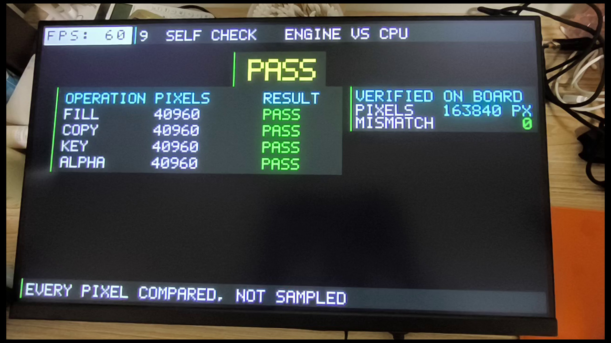

# 异构 2D 图形渲染加速引擎

<p>
  
  
  
  
  
  
  <a href="https://github.com/sleieur/ti60-bitblt-engine/actions/workflows/ci.yml"></a>
  <a href="https://github.com/sleieur/ti60-bitblt-engine/releases"></a>
</p>

> **2026 易灵思 FPGA 创新设计赛道参赛作品**
> 把像素搬运从 CPU 手里拿走：RISC-V 只下发指令，FPGA 里的 BitBlt 流水线直接完成拷贝、填充、色键与 α 混合，并自带 HDMI 720p60 时序输出。

**`双后端互校`** · **`算力与像素解耦`** · **`帧预算自适应`**

---

## 目录

- [为什么需要它](#为什么需要它)
- [实测指标](#实测指标)
- [系统结构](#系统结构)
- [一条指令如何变成一次 DDR 突发](#一条指令如何变成一次-ddr-突发)
- [十个演示场景](#十个演示场景)
- [仓库结构](#仓库结构)
- [复现步骤](#复现步骤)
- [三个创新点](#三个创新点)
- [文档与视频](#文档与视频)
- [硬件平台](#硬件平台)

---

## 为什么需要它

嵌入式 GUI 的渲染几乎全靠 CPU 逐像素写 DDR。一次 640×720 的整屏搬运，纯 C 实现要 **50~76 ms**，也就是整屏刷新只有 **7~8 Hz** —— 界面一复杂就卡成幻灯片。

瓶颈不在算力，在于「同一份像素要在 CPU 和 DDR 之间走两遍」这件事本身。本作品把这件事下移到硬件：CPU 只负责说「把哪个矩形搬到哪里」，坐标计算、突发读写、像素运算全部由 FPGA 完成。



## 实测指标



| 操作（整屏 1280×720） | 引擎耗时 | 等效带宽 |
|---|---:|---:|
| FILL 纯色填充 | **1.59 ms** | 1156 MB/s |
| COPY 位块拷贝 | **2.98 ms** | 618 MB/s |
| COLOUR KEY 抠色 | **3.00 ms** | — |
| ALPHA 混合 | **4.53 ms** | — |

| 对照项 | CPU 纯软件 | BitBlt 引擎 |
|---|---|---|
| 640×720 一帧 | 50~76 ms（7~8 Hz） | 1.49 ms（**60 FPS**） |
| 一帧 16.7 ms 预算内 | 不足 1/3 帧 | **5 次整屏 COPY** 或 3 次整屏 ALPHA |
| 60 FPS 同屏精灵 | < 100 | **933**（第 6 关 918 只时 48 FPS） |

> 所有数字都可在板上复现：串口 115200 每秒打印 `hw / cpu / sprites / frames / sim`，屏幕左上角是 FPGA 内部硬件 FPS 计数器，不是软件估算。

## 系统结构



RISC-V（Sapphire 软核）通过 AXI4-Lite 写寄存器下发任务；BitBlt 引擎作为第三个 AXI4 主机，与 HDMI 读主机、CPU 一起挂在 `axi_mux_3to1` 上。

仲裁优先级 **HDMI 读 > CPU > BitBlt**：扫描读取永不被渲染饿死，这是「边渲染边满帧显示」的前提。

## 一条指令如何变成一次 DDR 突发



| 阶段 | 做什么 |
|---|---|
| ① 任务 FIFO | 16 深，一条指令 = 一个二维矩形 + 像素运算类型 |
| ② 二维拆解 | 按行切成 1D 描述符，越界自动裁剪，不产生半行访问 |
| ③ 行级信用 | 最多 10 行在途，读 / 算 / 写三级流水天然重叠 |
| ④ 像素流水线 | 8 像素/拍，FILL / COPY / KEY / ALPHA 复用同一通路 |
| ⑤ 写回与提交 | 全部响应返回后才 `FRAME_LAST` 换页，画面无撕裂 |

SRC FIFO 1024×145 bit、DST FIFO 512×145 bit 把零散的行访问聚合成 128 bit 突发 —— 这是能跑满带宽的关键，也是「突发传输 + FIFO 缓存」的具体落点。

## 十个演示场景

| # | 场景 | 看点 |
|:--:|---|---|
| 01 | 总览 | 场景菜单 + 硬件 FPS 计数器 |
| 02 | SPLIT FILL | 左右半屏同组方块，CPU 58 ms/帧 vs 引擎 60 FPS |
| 03 | SPLIT COPY | 整屏大图搬运，CPU 76 ms/帧 vs 引擎 60 FPS |
| 04 | IMAGES | 静态图与 GIF 由引擎逐帧 COPY 播放，CPU 不参与解码 |
| 05 | ALPHA | α = 0/64/128/192/255 五档 + 8 路 0→255 扫描 |
| 06 | COLOUR KEY | 300 个品红底精灵，屏上不出现一个品红像素 |
| 07 | STARFALL | 弹幕游戏：三阶段 Boss、170~340 精灵、全程 60 FPS |
| 08 | SURVIVORS | 六关尸潮压测，精灵由 400 只加到 900 只以上，峰值 933 只仍 60 FPS |
| 09 | SELF CHECK | 四项各 40 960 像素、共 163 840 像素逐点比对，失配 0 |
| 10 | SUMMARY | 实测指标汇总 + 三个关键词 |

<table>
<tr>
<td width="50%"><br><sub><b>02 SPLIT FILL</b>：左 CPU 58 ms/帧，右引擎 60 FPS</sub></td>
<td width="50%"><br><sub><b>06 COLOUR KEY</b>：300 个精灵，品红底色从不落地</sub></td>
</tr>
<tr>
<td width="50%"><br><sub><b>05 ALPHA</b>：五档固定 α + 八路扫描</sub></td>
<td width="50%"><br><sub><b>08 SURVIVORS</b>：第 6 关 918 只掉到 48 FPS，峰值 933 只仍 60 FPS</sub></td>
</tr>
<tr>
<td width="50%"><br><sub><b>07 STARFALL</b>：PHASE 2 弹幕 + 338 精灵</sub></td>
<td width="50%"><br><sub><b>09 SELF CHECK</b>：163 840 像素比对，失配 0</sub></td>
</tr>
</table>

## 仓库结构

```
rtl/                        RTL 源码
  bitblt/                   引擎本体：core（任务调度/二维拆解）
                            sched（行级信用）· pix（像素流水线）· fifo
  common/                   AXI4 读主机、写主机（128 bit 突发）
  fb/                       双缓冲换页、AXI4-Lite 控制口、HDMI 720p60、FPS 叠字
  hdmi/                     TMDS 编码与视频时序
  ddr3_controller/          DDR3 控制器封装
par/ddr_demo_ti60/          Efinity 工程（xml / sdc / ip / outflow）
embedded_sw/bbShow/         RISC-V 固件（裸机）
  src/                      main / scenes / game / bitblt_driver / swr / font / art
  tools/                    图集生成、DDR 下载、主机端预览、录像取帧、布局检查
  build/                    bbShow.elf / .bin / .hex
docs/                       设计报告、插图、生成脚本、源码说明书
```

## 复现步骤

**1. 生成 bitstream**

Efinity 打开 `par/ddr_demo_ti60/ddr_demo_ti60.xml`
→ Run Synthesis → Place & Route → Generate Bitstream

**2. 编译固件**

```powershell
cd embedded_sw/bbShow
./build.ps1     # 需要 Efinity 自带的 RISC-V GCC 在 PATH 中
```

**3. 上板运行**

```text
① 烧写  par/ddr_demo_ti60/outflow/ddr_demo_ti60.bit
② 运行  embedded_sw/bbShow/build/bbShow.elf
③ 写入  tools/assets.bin → DDR 0x0600_0000（tools/load_assets.ps1）
   不写也能跑，只是 IMAGES 场景显示 NONE LOADED
④ 串口  115200 8N1，每秒一行 hw / cpu / sprites / frames / sim
```

**4. 不插板也能看界面**

```powershell
gcc tools/host_preview.c -o hp && ./hp    # 输出 10 张 1280×720 PPM
```

它复用同一份 `scenes.c`，所以排版与板上一模一样，改界面时不必反复烧板。

## 三个创新点

**① 双后端互校**
同一组图元、同一份数据，左半屏走 CPU 纯软件渲染、右半屏走硬件引擎，同屏并列跑。硬件加速最怕「快但画错」，这种并排对照让任何一处像素差异都无处躲藏；再叠加片上自校验（四项共 163 840 像素逐点比对），从「看起来对」升级为「逐像素可证」。

**② 算力与像素解耦**
CPU 只说「搬哪个矩形」，不再碰任何像素。渲染开销与屏幕分辨率、图元数量解绑 —— 加到 900 只以上的精灵，CPU 侧负载几乎不变，帧率仍是 60 FPS。

**③ 帧预算自适应**
软件每帧读硬件帧率，掉帧立即减半加点速率并清掉部分尸潮，帧率恢复后再逐步加量。实测尸潮压测在 933 只精灵时仍能跑满 60 FPS；第 6 关叠上 3 道激光后回落到 48~54 FPS，属于超出帧预算后的正常回退。

## 文档与视频

- 设计报告（7 表 9 图）：[docs/异构2D图形渲染加速引擎-设计报告.docx](docs/异构2D图形渲染加速引擎-设计报告.docx)
- 源码级说明：[docs/SOURCE_GUIDE.md](docs/SOURCE_GUIDE.md)
- 演示视频（2 分 35 秒）：见 [Releases](../../releases)

## 硬件平台

| | |
|---|---|
| FPGA | 易灵思 Ti60F225I3（F225 封装，Ti60 器件） |
| SoC | Sapphire RISC-V 软核（Efinity 生成） |
| 存储 | DDR3 256 MB，AXI4 128 bit @ 3 主机共享 |
| 显示 | HDMI 1280×720@60，RGB565，双缓冲换页 |
| 工具链 | Efinity 2023.2 / 2026.1，RISC-V GCC |

---

<sub>本项目为 2026 易灵思 FPGA 创新设计赛道参赛作品，著作权归作者所有。转载、引用请注明出处。</sub>
